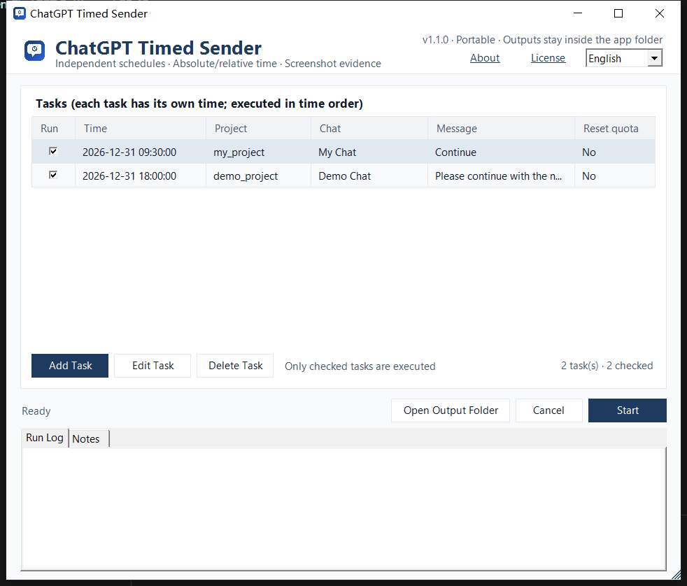

# ChatGPT Timed Sender

[English](README.md) | [中文](README.zh-CN.md)


A portable Windows tool that sends a scheduled message to a **specific project chat in the ChatGPT desktop app** — built for ChatGPT usage-limit scenarios (5-hour or weekly limits).

When the quota runs out, ChatGPT resets it after a waiting period that often falls during the night or your rest time. Instead of waking up to send a message manually, schedule tasks in advance. If you still have a reset credit, you can also reset usage and send immediately.

> Personal and non-commercial use only. Commercial use is prohibited. See [LICENSE](LICENSE).
> ChatGPT is a trademark of OpenAI. This project is not affiliated with OpenAI.



## Features

- **Portable EXE** — double-click `ChatGPTAutoSender.exe`; no installation, no console window.
- **Multiple tasks** — each task has its own time, project, chat, message and reset option. Check only the tasks you want to run.
- **Absolute or relative time** — type `yyyy-MM-dd HH:mm:ss` directly, or use the date/time pickers (they stay in sync). Relative time is calculated when you save.
- **Waits for UI feedback** — after every action the tool polls ChatGPT (window focus, chat title, composer, send-button state) instead of using fixed delays.
- **Safe failure handling** — if a project/chat cannot be confirmed, the task is skipped instead of sending to the wrong chat. A quota-blocked task does not stop other tasks.
- **Reset quota option** — if sending is blocked by quota, the task can click “Reset usage” once (consumes one reset credit). A warning appears when several checked tasks enable it.
- **Multi-monitor screenshots** — captures the ChatGPT window first (fallback: the full virtual desktop).
- **Bilingual UI** — English / 中文 switch in the app; all outputs stay inside the app folder.
- **Local only** — no telemetry, no network uploads; logs and screenshots are written under `output\`.

## How it differs from ChatGPT’s built-in Scheduled Tasks

ChatGPT has a native **Scheduled** feature. According to OpenAI’s help center:

- Scheduled tasks run as their own task conversations and are managed on the **Scheduled** page.
- Tasks created in a project **cannot access uploaded files or files stored in that project**.
- Scheduled tasks do **not** support GPTs or locked chats.
- Completed tasks still consume your plan’s usage allowance; active-task limits depend on the plan (3 for Free/Go, 5 for Plus, 10 for Business/Edu, 15 for Pro/Enterprise).
- Hourly schedules and exact delivery times require an eligible paid plan.

Native Tasks are the better choice if you only need a prompt to run on a schedule inside ChatGPT.

This tool targets a different case: **injecting a message into an existing project conversation**, with an optional quota-reset click and local screenshot evidence. It works by simulating the desktop UI, so it is inherently more fragile than an official feature and may break when ChatGPT’s UI changes.

## Similar projects

- [jetamine/chatgpt-auto_reset](https://github.com/jetamine/chatgpt-auto_reset) — Windows automation (Playwright + Task Scheduler) that sends a scheduled message to an existing ChatGPT conversation, aimed at the 5-hour limit. This is the closest match found.
- [adamlui/chatgpt-auto-continue](https://github.com/adamlui/chatgpt-auto-continue) — browser extension that automatically continues cut-off replies; not scheduled sending.
- [unsnooze](https://www.npmjs.com/package/unsnooze) — resumes usage-limit-stopped CLI coding sessions (Claude Code, Codex CLI, etc.) when the limit resets; not for the ChatGPT desktop UI.

## Requirements

- Windows 10/11 (x64 or x86)
- ChatGPT desktop app installed, signed in and running
- Windows PowerShell 5.1 and .NET Framework 4.x (included in Windows 10/11)
- No administrator rights required

## Quick start

1. Download or clone this repository. Keep the whole folder together (it is portable; you may move it to another drive).
2. Double-click `ChatGPTAutoSender.exe`.
3. Click **Add Task**, fill in time, project, chat and message.
4. Check the tasks you want, then click **Start**.

## Usage

### Add / edit tasks

| Field | Description |
| --- | --- |
| Time | Absolute (`yyyy-MM-dd HH:mm:ss`) or relative (from now X h Y m) |
| Project | Project name shown in ChatGPT’s project list; empty = keep current project |
| Chat | Chat title under that project; empty = use the current chat |
| Message | Text to send; any length, multi-line supported |
| Reset quota | Per-task: click “Reset usage” once if the send button is disabled by quota |

- Absolute time: type it or pick it; both stay in sync.
- Relative time: calculated from the moment you click **Save**.
- Tasks are sorted by time and executed in that order.
- Use **Edit** / **Delete** or double-click a row to modify a task.

### Run tasks

- Check the **Run** column for the tasks you want.
- Click **Start** and confirm. The status bar shows the next task and countdown.
- **Cancel** stops the current run immediately.
- If two or more checked tasks enable “Reset quota”, a warning explains that reset credits may be wasted.

### Output

Each run creates `output\yyyyMMdd_HHmmss\`:

```
run.log                Full execution log (English)
config.json            Snapshot of this run
task01\01_activated.png
task01\02_chat.png
task01\03_input.png
task01\04_after_send.png
```

Screenshots capture the ChatGPT window region (multi-monitor supported); if the window handle is unavailable, the whole virtual desktop is captured.

## Important notes

1. Keep ChatGPT running and signed in. This tool simulates mouse/keyboard input; it is not an official API.
2. Keep the computer awake and unlocked. Locking the screen or sleep will break keystrokes and screenshots.
3. Do not use the mouse or keyboard while a task is executing.
4. Project and chat names must match the UI exactly (case and punctuation matter). If a chat cannot be confirmed, the task is skipped rather than guessing.
5. “Reset quota” consumes a reset credit. Without it, a blocked message stays in the composer and the task is skipped; other tasks continue independently.
6. UI changes by ChatGPT may break element detection; check `run.log` for the failing step.
7. UI automation may conflict with OpenAI’s terms of service. Use at your own risk and only for personal, non-commercial purposes.

## FAQ

**Nothing happens after clicking Start?**
Confirm at least one task is checked and the time is correct. The status bar shows a countdown while waiting.

**Log shows a skipped task?**
Reasons include: project/chat not found, ChatGPT not in the foreground, composer not found, or quota-blocked sending. Each reason is written in `run.log` with the task index.

**Can it run while the screen is locked?**
No. Windows UI automation and screenshots require an unlocked desktop.

**Does it work with the English ChatGPT UI?**
Yes. Send/reset button detection supports English and Chinese UI labels.

**Why does a console window flash at startup?**
The app is powered by Windows PowerShell; the script hides the console automatically.

## Build

```powershell
powershell -NoProfile -ExecutionPolicy Bypass -File build\make_icon.ps1
powershell -NoProfile -ExecutionPolicy Bypass -File build\build.ps1
```

Requires the built-in .NET Framework `csc.exe`. Outputs `ChatGPTAutoSender.exe` and `app\Interop.dll`.

## Version

- **v1.1.0** — English/Chinese UI with language switch; About/License dialogs; English execution logs; bilingual send/reset button detection; layout polish for both languages.
- **v1.0.1** — task selection, running-state text fix, per-task failure isolation, reset-quota warning, author info.
- **v1.0.0** — first release.

## License

**Non-Commercial License.** Personal, educational and research use is allowed. Commercial use is strictly prohibited. Redistribution must retain the license and author attribution. See [LICENSE](LICENSE).

## Author

- GitHub: [@Yu010912](https://github.com/Yu010912)
- Email: 2206394025@qq.com
- Copyright © 2026 Yu010912

If this tool helps you, a star is appreciated.

## Sources

- [Scheduled tasks in ChatGPT — OpenAI Help Center](https://help.openai.com/en/articles/10291617-scheduled-tasks-in-chatgpt)
- [jetamine/chatgpt-auto_reset](https://github.com/jetamine/chatgpt-auto_reset)
- [adamlui/chatgpt-auto-continue](https://github.com/adamlui/chatgpt-auto-continue)
- [unsnooze (npm)](https://www.npmjs.com/package/unsnooze)
