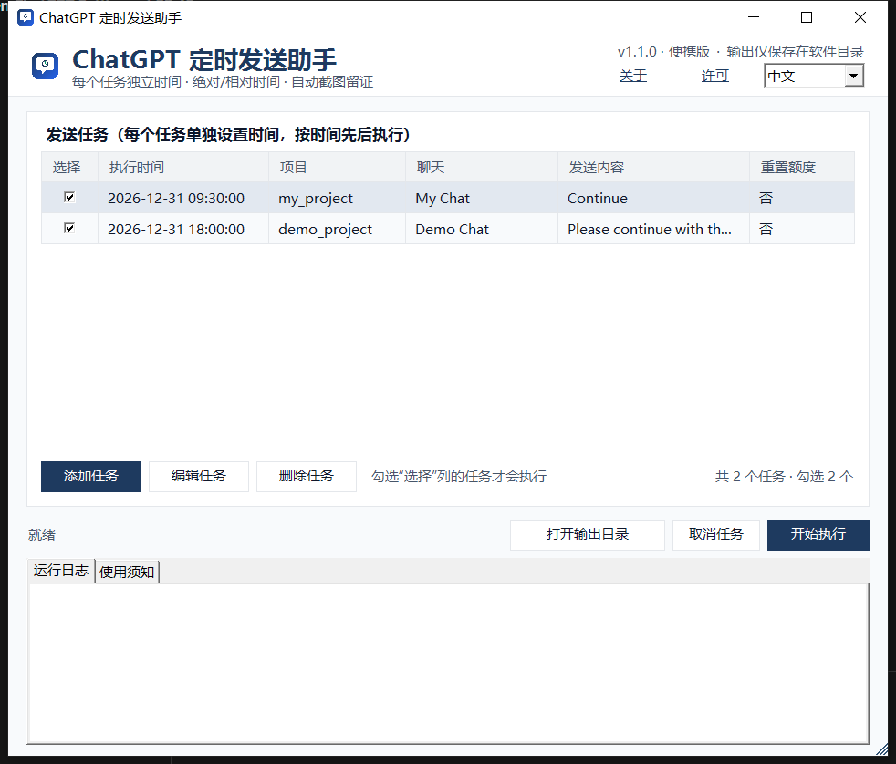

# ChatGPT 定时发送助手

[English](README.md) | [中文](README.zh-CN.md)


一个便携的 Windows 小工具：在指定时间向 **ChatGPT 桌面端里指定的项目聊天** 发送消息，专为 ChatGPT 的 5 小时 / 一周额度限制场景设计。

额度用完后，ChatGPT 需要等待一段时间自动重置，而重置时间往往正好是夜间或休息时间。使用本软件可以提前设置定时任务，无需半夜起来手动发送；如果仍有可用的重置机会，也可以选择“重置后立即发送”。

> 仅供个人学习与非商业用途，禁止商业使用。详见 [LICENSE](LICENSE)。
> ChatGPT 是 OpenAI 的商标，本项目与 OpenAI 无任何关联。



## 功能特性

- **便携 EXE**：双击 `ChatGPTAutoSender.exe` 即用，无需安装，无命令行窗口。
- **多任务**：每个任务独立设置时间、项目、聊天、内容与“重置额度”，只执行勾选的任务。
- **绝对 / 相对时间**：可直接输入 `yyyy-MM-dd HH:mm:ss`，也可用日期时间控件选择，两者自动同步；相对时间在保存时换算。
- **等待界面反馈**：每一步操作后轮询等待 ChatGPT 的窗口焦点、聊天标题、输入框与发送按钮状态，而不是固定延时。
- **安全失败处理**：无法确认项目/聊天时跳过发送，避免发错聊天；某个任务因额度失败不会中断其他任务。
- **额度重置选项**：发送按钮因额度被禁用时，可按任务设置点击一次“重置使用量”；多个任务同时启用时会给出风险提醒。
- **多显示器截图**：优先截取 ChatGPT 窗口区域，异常时回退截取完整虚拟桌面。
- **中英双语界面**：应用内可切换 English / 中文；所有日志、截图、配置只保存在软件目录。
- **纯本地**：无联网上传、无遥测。

## 与 ChatGPT 原生 Scheduled Tasks 的区别

ChatGPT 已内置 **Scheduled（定时任务）**。根据 OpenAI 帮助中心：

- 定时任务运行在各自的任务会话中，在 **Scheduled** 页面管理。
- 在项目中创建的任务**无法访问该项目上传的文件或项目文件**。
- 定时任务不支持 GPTs、不支持锁定聊天。
- 任务执行仍会消耗套餐用量；可启用的任务数量依套餐而定（Free/Go 3 个、Plus 5 个、Business/Edu 10 个、Pro/Enterprise 15 个）。
- 每小时频率与精确时间需要符合条件的付费套餐。

如果你只是想让 ChatGPT 在固定时间执行一段提示词，原生 Tasks 更合适。

本工具针对的是另一个场景：**向已存在的项目聊天中注入消息**，可选自动点击额度重置，并留下本地截图证据。由于通过模拟桌面界面实现，它比官方功能更脆弱，ChatGPT 界面改版可能导致失效。

## 同类项目

- [jetamine/chatgpt-auto_reset](https://github.com/jetamine/chatgpt-auto_reset)：Windows 自动化（Playwright + 任务计划程序），定时向已存在的 ChatGPT 会话发送消息，面向 5 小时额度限制，是目前找到的最接近的项目。
- [adamlui/chatgpt-auto-continue](https://github.com/adamlui/chatgpt-auto-continue)：浏览器扩展，自动继续被截断的回复，不属于定时发送。
- [unsnooze](https://www.npmjs.com/package/unsnooze)：额度重置后自动恢复被限制的 CLI 编程会话（Claude Code、Codex CLI 等），不针对 ChatGPT 桌面端。

## 系统要求

- Windows 10 / 11（x64 或 x86）
- 已安装、登录并运行 ChatGPT 桌面端
- 系统自带 Windows PowerShell 5.1 与 .NET Framework 4.x
- 无需管理员权限

## 快速开始

1. 下载或克隆本仓库，保持整个文件夹完整（可直接移动到其他盘）。
2. 双击 `ChatGPTAutoSender.exe`。
3. 点击「添加任务」，填写时间、项目、聊天、发送内容。
4. 勾选要执行的任务，点击「开始执行」。

## 使用说明

### 添加 / 编辑任务

| 字段 | 说明 |
| --- | --- |
| 执行时间 | 绝对时间（`yyyy-MM-dd HH:mm:ss`）或相对时间（从现在起 X 时 Y 分） |
| 项目名称 | ChatGPT 项目列表中的名称；留空表示不切换项目 |
| 聊天名称 | 该项目下的聊天标题；留空表示使用当前聊天 |
| 发送内容 | 要发送的文本，不限长度，支持多行 |
| 重置额度 | 每个任务独立：发送被额度禁用时是否点击一次“重置使用量” |

- 绝对时间可直接输入或使用控件选择，两者同步。
- 相对时间以点击「保存」时的当前时间为基准。
- 任务按时间先后自动排序执行。
- 选中行后可「编辑」或「删除」，也可双击行编辑。

### 执行任务

- 在「选择」列勾选要执行的任务；
- 点击「开始执行」并确认，状态栏显示下一任务与倒计时；
- 「取消任务」立即停止本次运行；
- 若勾选的任务中有 2 个及以上启用“重置额度”，会提示可能浪费重置机会。

### 输出结构

每次运行创建 `output\年月日_时分秒\`：

```
run.log                完整执行日志（英文）
config.json            本次运行配置快照
task01\01_activated.png
task01\02_chat.png
task01\03_input.png
task01\04_after_send.png
```

截图优先截取 ChatGPT 窗口区域，支持多显示器；窗口句柄异常时回退截取完整虚拟桌面。

## 注意事项

1. ChatGPT 需保持运行并已登录；本工具模拟鼠标键盘，不是官方 API。
2. 执行期间请保持电脑唤醒且未锁屏，锁屏或睡眠会导致按键与截图失效。
3. 自动化执行期间请勿操作键鼠，避免干扰输入。
4. 项目名、聊天名需与界面显示完全一致（区分大小写与标点）；无法确认聊天时会跳过该任务。
5. 勾选“重置额度”会消耗一次重置机会；未勾选时消息保留在输入框、该任务被跳过，其他任务继续独立执行。
6. ChatGPT 界面改版可能导致控件定位失败，请查看 `run.log` 中的失败步骤。
7. 界面自动化可能与 OpenAI 服务条款存在冲突，请自行评估风险，仅用于个人非商业用途。

## 常见问题

**点击开始后没有反应？**
请确认至少勾选了一个任务且时间正确；等待期间状态栏会显示倒计时。

**日志里出现跳过？**
原因包括：未找到项目/聊天、ChatGPT 未在前台、未找到输入框、发送被额度拦截等，日志会写明任务编号与原因。

**锁屏后还能执行吗？**
不能。Windows 界面自动化与截图需要未锁屏的桌面会话。

**支持英文版 ChatGPT 吗？**
支持。程序会同时识别中英文的发送/重置按钮。

**启动时为什么有黑色窗口一闪？**
程序基于系统 PowerShell 运行，脚本会自动隐藏该控制台窗口。

## 构建

```powershell
powershell -NoProfile -ExecutionPolicy Bypass -File build\make_icon.ps1
powershell -NoProfile -ExecutionPolicy Bypass -File build\build.ps1
```

依赖系统自带 .NET Framework 的 `csc.exe`，生成 `ChatGPTAutoSender.exe` 与 `app\Interop.dll`。

## 版本

- **v1.1.0**：中英双语界面与语言切换；关于/许可对话框；英文执行日志；中英文发送/重置按钮识别；双语排版修正。
- **v1.0.1**：任务勾选、运行态文字修复、单任务失败隔离、重置额度提醒、作者信息。
- **v1.0.0**：首次发布。

## 许可

采用 **非商业许可**：允许个人学习、研究与非商业用途；禁止任何商业使用；再分发需保留许可与作者信息。详见 [LICENSE](LICENSE)。

## 作者

- GitHub：[@Yu010912](https://github.com/Yu010912)
- 邮箱：2206394025@qq.com
- 版权：Copyright © 2026 Yu010912

如果这个工具对你有帮助，欢迎点一个 Star。

## 资料来源

- [Scheduled tasks in ChatGPT — OpenAI Help Center](https://help.openai.com/en/articles/10291617-scheduled-tasks-in-chatgpt)
- [jetamine/chatgpt-auto_reset](https://github.com/jetamine/chatgpt-auto_reset)
- [adamlui/chatgpt-auto-continue](https://github.com/adamlui/chatgpt-auto-continue)
- [unsnooze (npm)](https://www.npmjs.com/package/unsnooze)
